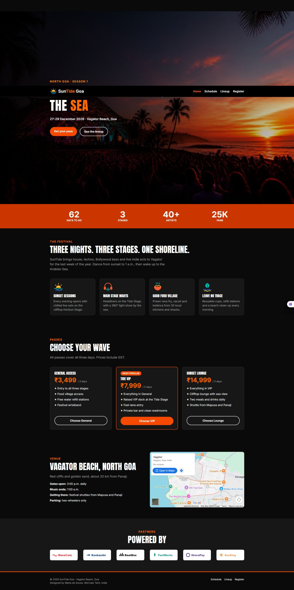
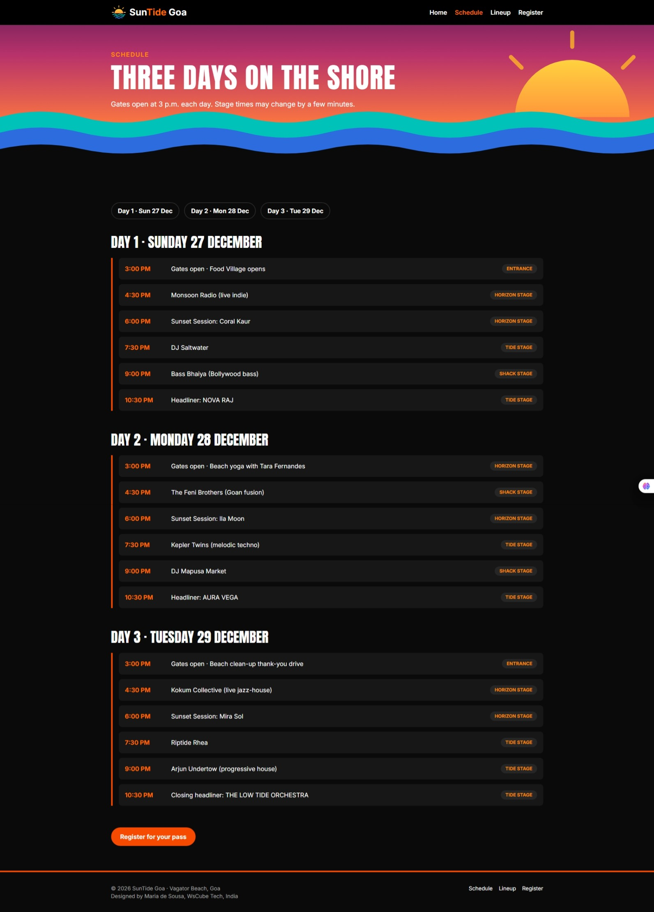
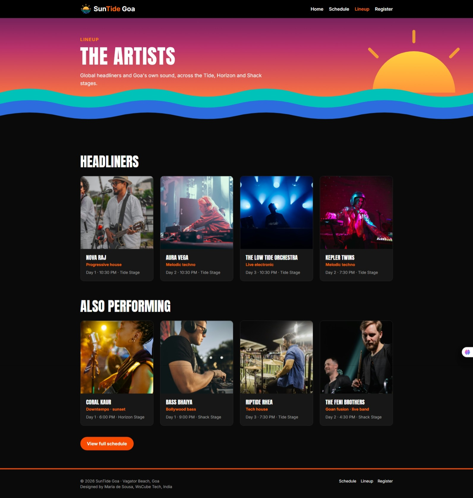
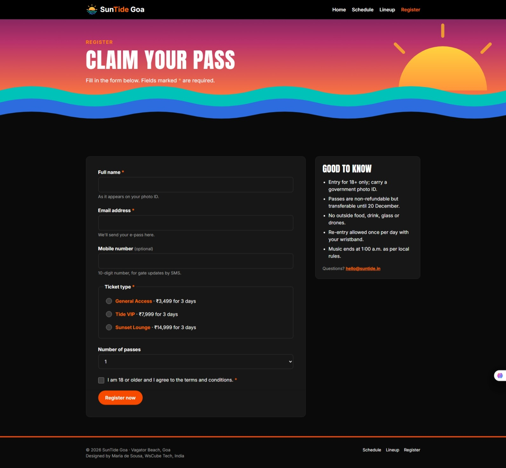
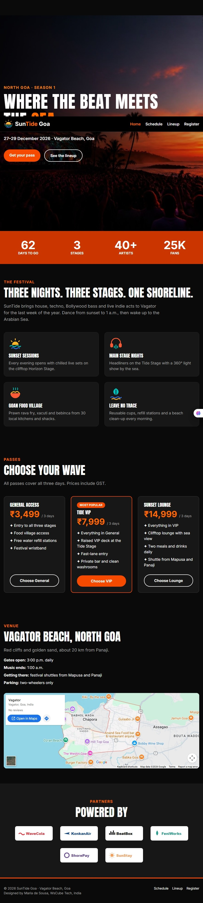

# SunTide Goa 2026

A multi-page website for **SunTide Goa 2026**, a fictional three-day beach music festival at Vagator Beach, North Goa (27–29 December 2026). Visitors can read about the festival and the team behind it, check the schedule and lineup, compare passes, and register.

Built as my Milestone 1 project for the Full Stack Development Course at WsCube Tech, using only **HTML, CSS and Tailwind CSS**.

## Live Demo

https://suntide-goa.vercel.app


## Pages

| Page | What it shows |
| --- | --- |
| `index.html` | Hero, quick facts, festival highlights, pass prices, venue map and sponsors |
| `about.html` | The festival's story, its three promises, a timeline, the team and an FAQ |
| `schedule.html` | Day-wise timetable for all three days, with "jump to day" links |
| `lineup.html` | Artist cards with genre, day, time and stage |
| `register.html` | Registration form and festival rules |
| `thank-you.html` | Confirmation page shown after the form is filled in correctly |


## Screenshots

| Home (desktop) | About (desktop) |
| --- | --- |
|  |  |

| Schedule | Lineup | Register |
| --- | --- | --- |
|  |  |  |

| Home (mobile) |
| --- |
|  |


## How to Run Locally

1. Download or clone the repository.
2. Open the folder in VS Code.
3. Run `npm install` in the VS Code terminal (installs Tailwind CSS and the CLI).
4. Open `index.html` in your browser, or right-click it and choose **Open with Live Server**.


### Tailwind CLI setup (how `css/output.css` is made)

1. Install Tailwind CSS and the CLI:
   ```bash
   npm install tailwindcss @tailwindcss/cli
   ```
2. The first line of `css/style.css` imports Tailwind. My own CSS comes after it:
   ```css
   @import "tailwindcss";
   ```
3. Start the build. The CLI scans my HTML files for Tailwind classes and writes them, together with my own CSS, into `css/output.css`:
   ```bash
   npx @tailwindcss/cli -i ./css/style.css -o ./css/output.css --watch
   ```
4. Every page links the built file in its `<head>`:
   ```html
   <link rel="stylesheet" href="css/output.css">
   ```

## Note

SunTide Goa is a fictional event created for a course project. The registration form is a demo: no data is sent anywhere and no tickets are issued.

## Author

**Maria de Sousa**, Full Stack Development student at WsCube Tech, India
https://github.com/mariadesousasfx71-source/suntide-goa-2026
